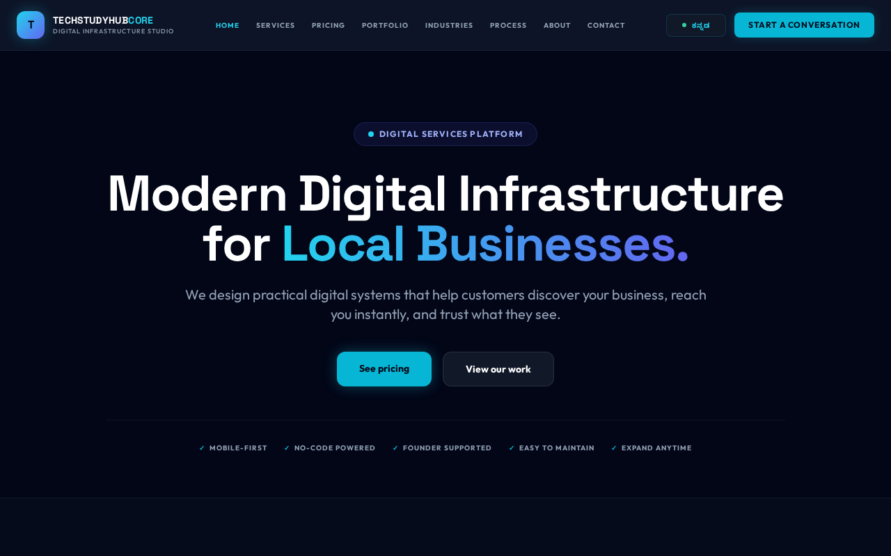
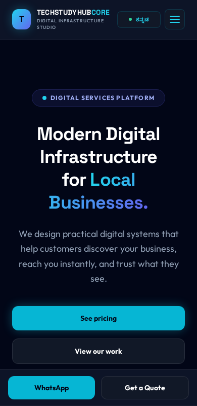
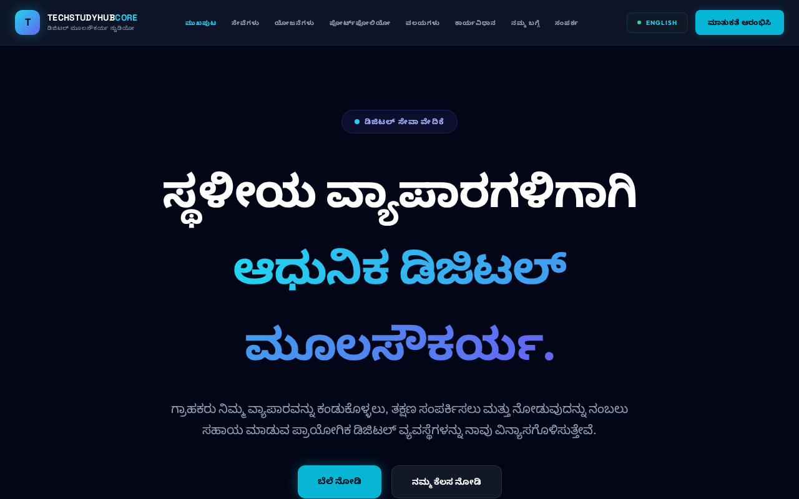
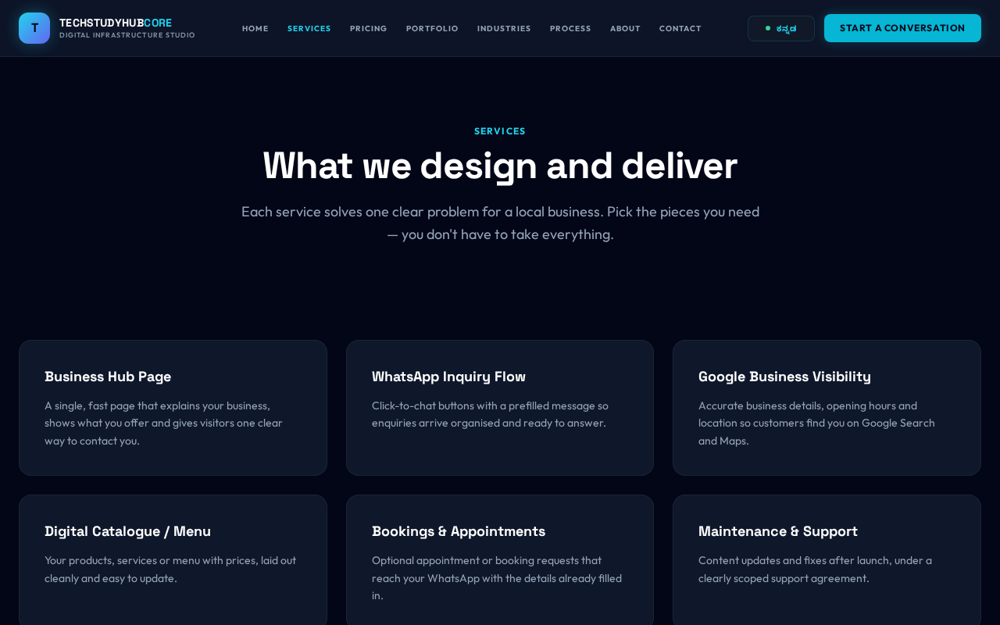
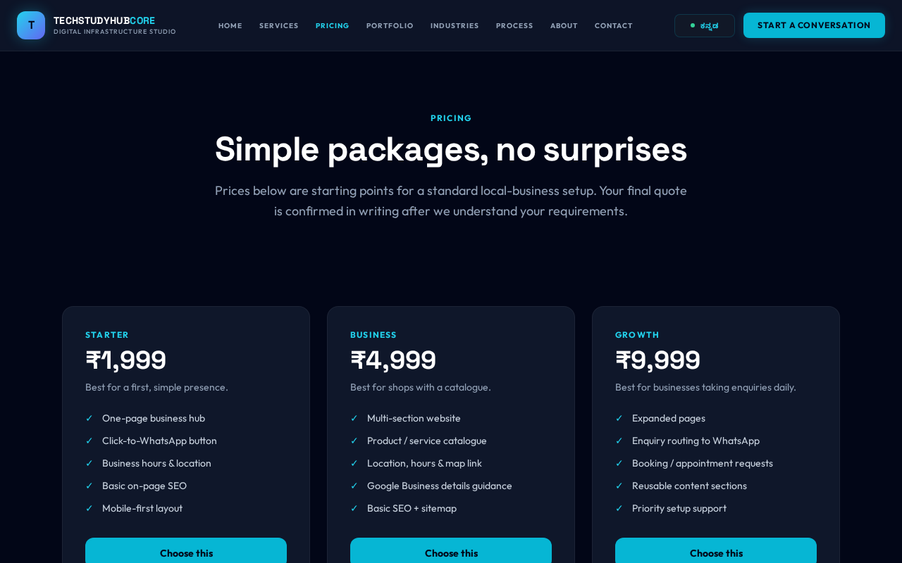

# TECHSTUDYHUBCORE — Digital Setup

**Practical digital presence. Clear customer connections. Built for local businesses.**

A bilingual (English / ಕನ್ನಡ) digital services website for TECHSTUDYHUBCORE, a digital
infrastructure studio in Koppal, Karnataka. The site helps local businesses understand
what a professional online presence involves, see transparent pricing, and start a
conversation over WhatsApp or a short onboarding form.

---

## Project overview and the problem it solves

Many local businesses in smaller towns have no reliable online presence: they cannot be
found on Google, their phone line is busy, and there is no simple way to show what they
sell. This site exists to explain, in plain language and in two languages, the practical
pieces that fix that — a findable page, a WhatsApp route for enquiries, and accurate
Google Business information — and to make starting that process effortless.

The website itself is a **marketing and onboarding front door**. It is not an app, a
dashboard, or a store; it presents the service, the process, the pricing and the
portfolio, and routes interested visitors to a conversation.

---

## Live website and contact

| | |
|---|---|
| **Website** | https://digitalsetup.techstudyhubcore.in/ |
| **WhatsApp** | +91 94807 27214 |
| **Onboarding form** | https://forms.gle/dDr35dUyyjNQ6ArCA |
| **Founder** | Kartik H., Koppal, Karnataka, India |

> The production domain, canonical URLs and structured data all reference
> `digitalsetup.techstudyhubcore.in`. If the primary domain changes, update the
> canonical tags, the Open Graph URLs, `sitemap.xml`, `robots.txt` and the JSON-LD
> blocks together.

---

## Screenshots

Desktop, mobile and the Kannada interface:

| Home (desktop) | Home (mobile) | Kannada interface |
| --- | --- | --- |
|  |  |  |

| Services | Pricing |
| --- | --- |
|  |  |

Regenerate these after any design change so the README never shows a stale interface.

---

## Services and target business categories

**Services**
- Business hub page — a fast, mobile-first page that shows who you are and how to reach you.
- WhatsApp inquiry flow — click-to-chat buttons with a prefilled message.
- Google Business visibility — accurate hours, location and contact details.
- Digital catalogue / menu — products, services and prices on one clean page.
- Bookings & appointments — optional appointment requests routed to WhatsApp.
- Maintenance & support — scoped updates after launch.

**Target categories**
Shops & retail · Bakeries & food · Coaching centres · Clinics & healthcare ·
Salons & services · other local businesses.

---

## Key features

- **Bilingual interface** — every page ships English and Kannada copy. The toggle in the
  navigation switches the whole site and remembers the choice (`localStorage`).
- **Mobile-first** — large touch targets, a fixed mobile action bar, and layouts tested
  from small phones upward.
- **Clear conversion paths** — every page ends with a WhatsApp action and a link to the
  onboarding form.
- **Accessible by default** — skip-to-content link, visible focus states, semantic
  landmarks, ARIA labels on the menu and language toggle, and full `prefers-reduced-motion`
  support.
- **Honest content** — no invented testimonials, client names, customer counts or
  performance guarantees. Concept work is always labelled as concept work.

---

## Technology stack and project architecture

Plain, dependency-light static HTML, CSS and JavaScript. No build step is required to
serve the site.

- **Markup:** hand-written HTML5, one file per page.
- **Styling:** Tailwind CSS compiled to a static stylesheet (`css/tailwind.css`) — no
  runtime CDN dependency — plus two hand-written stylesheets (`css/styles.css` for design
  tokens and components, `css/responsive.css` for breakpoints and print).
- **JavaScript:** three small vanilla files, no framework:
  - `js/language.js` — the English / Kannada switcher.
  - `js/main.js` — central contact config (WhatsApp number, onboarding form) so every
    CTA stays consistent.
  - `js/interactions.js` — scroll reveal, mobile menu, optional custom cursor, footer year.
- **Fonts:** Space Grotesk, Outfit and Noto Sans Kannada from Google Fonts.

### Structure

```
digital-setup/
├── index.html            # Home
├── services.html         # What we deliver
├── pricing.html          # Packages, add-ons, pricing FAQ
├── portfolio.html        # Labelled concept projects
├── industries.html       # Solutions by business category
├── process.html          # Six-step workflow
├── about.html            # Studio, approach, what we do / don't
├── contact.html          # WhatsApp + onboarding form
├── privacy.html          # Privacy policy
├── terms.html            # Terms & conditions
├── support-policy.html   # Refund & support policy
├── 404.html              # Not found
├── robots.txt
├── sitemap.xml
├── README.md
├── assets/
│   ├── images/           # og-cover.png and other imagery
│   ├── icons/
│   └── screenshots/
├── css/
│   ├── styles.css
│   └── responsive.css
└── js/
    ├── language.js
    ├── main.js
    └── interactions.js
```

The header, footer and mobile action bar markup is repeated across pages (there is no
server-side include). If that repetition becomes a maintenance burden, introduce a small
static-site build step rather than a full framework.

---

## Local setup

No installation is needed.

```bash
git clone https://github.com/kartik-h6/digital-setup.git
cd digital-setup

# serve locally (any static server works)
python3 -m http.server 8000
# then open http://localhost:8000
```

Because the site uses only relative paths (`css/…`, `js/…`), it works from any static
host, including `file://`.

### Rebuilding the CSS (only if you change classes or the theme)

The compiled `css/tailwind.css` is committed, so no build is needed to run the site. If
you edit utility classes or the theme, regenerate it:

```bash
npm install
npm run build:css
```

---

## Deployment on Netlify

1. Push the repository to GitHub.
2. In Netlify, choose **Add new site → Import an existing project** and select this repo.
3. **Build command:** leave empty. **Publish directory:** `/` (repository root).
4. Add the custom domain and enable HTTPS.
5. Confirm `robots.txt` and `sitemap.xml` resolve on the production domain, then submit
   the sitemap in Google Search Console.

No environment variables are required for the static site. Any future server-side
feature (for example an AI endpoint) must run as a Netlify Function — never in client
JavaScript.

---

## SEO, accessibility and performance approach

- **Per-page metadata** — a unique `<title>` and meta description, a self-referencing
  canonical URL, and a page-specific Open Graph image on every indexable page.
- **Structured data** — `Organization`, `WebSite`, `LocalBusiness`, `Service`, `FAQPage`
  and `BreadcrumbList` JSON-LD, scoped to the pages where each is accurate.
- **Sitemap & robots** — `sitemap.xml` lists the canonical pages; `robots.txt` allows
  crawling and points to the sitemap.
- **Language** — the site serves both languages from the same URL via a client-side
  toggle. Misleading `hreflang` alternates that pointed several languages at one URL were
  removed. If genuinely separate language URLs are introduced later, add correct
  `hreflang` at that point.
- **Accessibility** — semantic landmarks, keyboard-visible focus, a skip link, reduced-motion
  support, and descriptive labels. The custom cursor is a desktop-only enhancement; the
  normal cursor is never hidden on touch devices or when motion is reduced.
- **Performance** — no framework, no large images, lazy where possible. Core Web Vitals
  should be measured with real Lighthouse runs before making any performance claims.

---

## Privacy, third-party integrations and security boundaries

- **Onboarding form** — Google Forms (responses governed by Google's terms).
- **Contact** — WhatsApp deep links (`wa.me`); messaging governed by WhatsApp's terms.
- **Hosting** — Netlify.
- **No tracking** — the site runs no advertising or analytics trackers of its own.

**Security boundaries**
- No API keys, tokens or secrets belong in this repository. Anything sensitive must live
  in server-side environment variables (for example a Netlify Function).
- Do not send customer form data to any third-party AI provider without clear disclosure
  and consent.

See `privacy.html`, `terms.html` and `support-policy.html` for the full policies. These are
general templates and should be reviewed against actual business practices and applicable
law.

---

## Roadmap and limitations

**Known limitations**
- The pages are static; content edits are made in the HTML.
- Some long secondary paragraphs (parts of the legal pages and the pricing FAQ) are
  currently English-only and fall back to English in Kannada mode.

**Roadmap (not yet implemented)**
- Three polished, publicly linked concept demos (bakery, coaching centre, retail).
- Additional Kannada coverage for legal and FAQ copy.
- AI-assisted production workflow: reusable prompt and QA checklists (no public AI API).
- A client-brief → website-draft pipeline driven by the onboarding form responses.
- Optional customer assistant — only if real interactions show it solves a recurring
  problem, and only with a server-side key.

> Planned AI features are **not** implemented. Nothing in this repository should be read
> as a claim that they are.

---

## Contributing

This is a small, single-maintainer project. If you spot a broken link, an accessibility
issue or an inaccurate statement, open an issue or a pull request describing the problem
and the page it affects. Please keep the site's guiding principles intact: plain language,
honesty about what is delivered, and no invented results.

---

## License

No open-source license is currently declared. All rights reserved by TECHSTUDYHUBCORE
unless a license is added.
